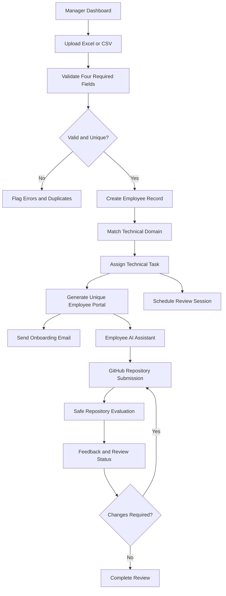
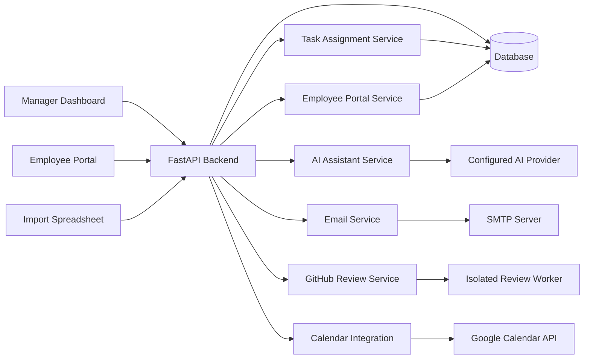

# AI Employee Task & Review System

### Intelligent Employee Onboarding · Domain-Based Task Assignment · AI-Powered Reviews

An intelligent employee onboarding and task evaluation platform that simplifies employee registration, automates technical task assignments, provides personalized AI employee assistants, coordinates review sessions, and streamlines submission evaluation.

The system is designed around a simple principle: **collect only essential employee information, automate repetitive management tasks, and provide every employee with a clear, personalized path to complete their assigned work.**

---

## Table of Contents

- [Overview](#overview)
- [Key Features](#key-features)
- [System Workflow](#system-workflow)
- [Employee Import Format](#employee-import-format)
- [Core Modules](#core-modules)
- [Technology Stack](#technology-stack)
- [System Architecture](#system-architecture)
- [Project Structure](#project-structure)
- [Prerequisites](#prerequisites)
- [Installation and Setup](#installation-and-setup)
- [Environment Configuration](#environment-configuration)
- [Running the Application](#running-the-application)
- [API Documentation](#api-documentation)
- [Security and Privacy](#security-and-privacy)
- [Testing and Validation](#testing-and-validation)
- [Troubleshooting](#troubleshooting)
- [Roadmap](#roadmap)
- [Contributing](#contributing)
- [License](#license)

---

## Overview

Managing employee onboarding and technical assessments manually can involve repetitive data entry, assigning inappropriate tasks, sending individual emails, coordinating meetings, and reviewing submissions one by one.

The AI Employee Task & Review System aims to bring these activities together in a centralized platform.

Managers can import employee information through an Excel or CSV spreadsheet. The application validates records, detects duplicate email addresses, maps technical domains to relevant tasks, and creates a personalized employee portal.

Each employee can access their assigned task, interact with an AI assistant, review task requirements, submit a GitHub repository, and receive feedback through the review workflow.

### Primary Objectives

- Automate employee onboarding.
- Eliminate unnecessary resume and education requirements.
- Assign technical tasks based on employee domains.
- Provide personalized employee AI assistant links.
- Simplify review meeting coordination.
- Support structured repository evaluation.
- Reduce repetitive administrative work.
- Maintain a consistent, transparent assessment process.

## Key Features

### 1. Employee Management Dashboard

A centralized dashboard for managing employee records and onboarding workflows.

- Import employees through `.xlsx`, `.xls`, or `.csv` files, where supported.
- Validate required fields before processing records.
- Identify duplicate email addresses.
- Report invalid or incomplete records.
- Assign domain-matched technical tasks.
- Track onboarding and review status.
- Monitor employee task submissions.
- View task assignments and employee portal links.

### 2. Minimal Employee Data Collection

The application uses exactly four required employee fields.

| Required column | Purpose |
|---|---|
| `Employee Name` | Identifies the employee |
| `Email Address` | Supports communication and duplicate detection |
| `Phone Number` | Stores the employee's contact number |
| `Technical Domain` | Determines the relevant task category |

**Resumes, educational qualifications, work experience, and previous employment history are not required.**

The import workflow should validate these four fields without rejecting an otherwise valid employee because optional profile information is absent.

### 3. Automated Data Validation

The import pipeline is designed to check:

- Missing employee names.
- Missing or malformed email addresses.
- Missing phone numbers.
- Missing technical domains.
- Duplicate email addresses.
- Unsupported file formats.
- Empty spreadsheet rows.
- Invalid or unrecognized domain values.

Duplicate email addresses should be flagged before creating duplicate employee accounts. Managers should receive a clear import summary indicating accepted records, rejected records, and duplicate entries.

### 4. Domain-Based Task Assignment

The task assignment module maps employee technical domains to suitable technical assessments.

| Technical domain | Example task |
|---|---|
| Frontend Development | Build a responsive dashboard using React |
| Backend Development | Develop a REST API with authentication |
| AI / Machine Learning | Build a model-backed prediction service |
| Cybersecurity | Perform a controlled security configuration review |
| Data Analytics | Analyze a dataset and produce a dashboard |
| DevOps / Cloud | Create a containerized deployment pipeline |
| Mobile Development | Develop a mobile application prototype |
| QA / Test Automation | Design automated tests for an application |

Tasks should contain a description, expected deliverables, acceptance criteria, deadline, and submission instructions.

The assignment system should use configurable task definitions rather than relying entirely on hardcoded domain names.

### 5. Personalized Employee AI Bot

Each successfully onboarded employee receives a unique portal URL.

The employee portal is intended to provide:

- Personalized task instructions.
- Acceptance criteria and deadlines.
- A conversational assistant for task-related questions.
- Text-based interaction.
- Optional voice input and spoken responses.
- GitHub repository submission.
- Review status and feedback.

The assistant should answer using the assigned task context and avoid inventing requirements that are not present in the task specification.

### 6. Automated Onboarding Emails

The email module is designed to send personalized onboarding messages containing:

- Employee greeting.
- Assigned technical task.
- Task deadline.
- Employee AI Bot link.
- Submission instructions.
- Review session details, when available.

Email delivery requires valid SMTP configuration. Failed deliveries should be logged and retried safely where supported.

### 7. Google Meet Review Sessions

The intended scheduling workflow integrates with Google Calendar to coordinate review sessions.

Planned capabilities include:

- Configurable meeting duration.
- Review date and time selection.
- Calendar event creation.
- Google Meet conference-link generation.
- Employee meeting invitations.
- Review status tracking.

**Integration note:** Automatic meeting creation requires Google Calendar API credentials, OAuth configuration, appropriate permissions, and implementation of the calendar integration. A meeting link must not be presented as confirmed unless it has actually been created.

### 8. GitHub Repository Submission and Review

Employees can submit a GitHub repository URL for technical evaluation.

The review workflow is designed to:

1. Validate the submitted repository URL.
2. Retrieve accessible repository information.
3. Compare available implementation evidence with task requirements.
4. Execute permitted automated checks in an isolated environment when configured.
5. Generate structured findings and improvement suggestions.
6. Present review results to the manager and employee.
7. Support resubmission and subsequent review.

Repository accessibility, branch selection, dependency availability, test execution, and AI provider configuration can affect the results.

**Security requirement:** Never execute untrusted repository code directly on the application server. Use a disposable sandbox or isolated worker with restricted network access, resource limits, and no access to application secrets.

---

## System Workflow



The diagram describes the intended end-to-end workflow. Individual steps become operational only when their corresponding integrations and configuration are implemented.

---

## Employee Import Format

Your spreadsheet must contain these exact column names:

```csv
Employee Name,Email Address,Phone Number,Technical Domain
Aarav Sharma,aarav.sharma@example.com,+91-9000010001,Frontend Development
Diya Patel,diya.patel@example.com,+91-9000010002,Backend Development
Ishaan Kumar,ishaan.kumar@example.com,+91-9000010003,AI / Machine Learning
Ananya Reddy,ananya.reddy@example.com,+91-9000010004,Cybersecurity
```

### Import Rules

1. Keep the column headers unchanged unless the importer explicitly supports aliases.
2. Use one employee per row.
3. Provide a valid email address for every employee.
4. Use a recognized technical domain.
5. Avoid duplicate email addresses.
6. Keep phone numbers as text to preserve the `+` prefix.
7. Do not add resumes, education, or experience as required columns.

Example technical domains can be configured according to the organization's assessment categories.

---

## Technology Stack

The intended stack is organized into the following layers.

| Layer | Technology | Responsibility |
|---|---|---|
| Frontend | React | Dashboard and employee portal |
| Language | TypeScript | Type-safe frontend development |
| Build tooling | Vite | Development server and production builds |
| Styling | Tailwind CSS | Responsive interface design |
| Backend | FastAPI | REST API and application logic |
| Language | Python | Validation, task assignment, and review workflows |
| Database | SQLite / PostgreSQL | Persistent employee and task records |
| Background jobs | Redis / Celery, if configured | Asynchronous processing |
| AI provider | Configurable LLM integration | Contextual task assistance and review summaries |
| Email | SMTP | Onboarding and review notifications |
| Repository integration | GitHub API | Repository metadata and submission handling |
| Meeting integration | Google Calendar API | Calendar events and Meet links |

The actual dependencies and enabled integrations are determined by the code and configuration present in the repository.

---

## System Architecture



### Architecture Principles

- Separate frontend presentation from backend business logic.
- Keep employee records and task assignments persistent.
- Validate uploaded data on the server.
- Keep credentials outside source control.
- Process long-running jobs asynchronously when a worker is configured.
- Treat external repository content as untrusted input.
- Make integration failures visible rather than silently reporting success.

---

## Project Structure

The following is a suggested logical structure. Adjust it to match the files actually included in your repository.

```text
ai-employee-review/
├── backend/
│   ├── app/
│   │   ├── main.py
│   │   ├── api/
│   │   ├── models/
│   │   ├── schemas/
│   │   ├── services/
│   │   └── core/
│   ├── tests/
│   ├── requirements.txt
│   └── .env.example
├── frontend/
│   ├── src/
│   │   ├── components/
│   │   ├── pages/
│   │   ├── services/
│   │   └── types/
│   ├── package.json
│   └── vite.config.ts
├── sample-data/
│   └── sample-employees.csv
├── docker-compose.yml
├── .gitignore
└── README.md
```

This structure is illustrative and should not be interpreted as a guarantee that every listed module exists in the current implementation.

---

## Prerequisites

Install the following tools before running the project:

- Python 3.11 or a compatible version supported by the backend dependencies.
- Node.js and npm.
- Git.
- Visual Studio Code or another code editor.
- A modern browser.

Optional services:

- PostgreSQL for production-style persistent storage.
- Redis and Celery for background jobs.
- An SMTP provider for email delivery.
- An AI provider API key for generative responses.
- Google Cloud credentials for Calendar and Meet integration.
- GitHub credentials for authenticated repository access.

---

## Installation and Setup

### 1. Clone the repository

```bash
git clone <YOUR_REPOSITORY_URL>
cd ai-employee-review
```

Replace `<YOUR_REPOSITORY_URL>` with your actual Git repository URL.

### 2. Set up the backend

From the project root:

**Windows PowerShell**

```powershell
cd backend
py -m venv .venv
.\.venv\Scripts\Activate.ps1
python -m pip install --upgrade pip
pip install -r requirements.txt
Copy-Item .env.example .env
```

**Linux / macOS**

```bash
cd backend
python3 -m venv .venv
source .venv/bin/activate
python -m pip install --upgrade pip
pip install -r requirements.txt
cp .env.example .env
```

If your repository uses a different backend entry point or configuration filename, follow the instructions in that directory.

### 3. Configure environment variables

Open `backend/.env` and configure the values supported by the implementation.

Never commit real credentials to Git.

### 4. Start the backend

If the FastAPI application exposes `app.main:app`:

```bash
uvicorn app.main:app --reload --host 127.0.0.1 --port 8000
```

The backend should then be available at:

- API base URL: `http://127.0.0.1:8000`
- Swagger documentation: `http://127.0.0.1:8000/docs`
- ReDoc documentation: `http://127.0.0.1:8000/redoc`

The documentation pages are available only while the backend is running and the routes are enabled.

### 5. Start the frontend

Open another terminal and navigate to the frontend directory:

```bash
cd frontend
npm install
npm run dev
```

Open the local URL printed by Vite, commonly `http://localhost:5173`.

For production deployment, build the frontend using the script provided in `package.json`.

```bash
npm run build
```

---

## Environment Configuration

A typical configuration may include the following variables, depending on the integrations implemented in your version:

```dotenv
# Application
APP_ENV=development
APP_BASE_URL=http://127.0.0.1:8000
PUBLIC_APP_URL=http://localhost:5173

# Database
DATABASE_URL=sqlite:///./employee_review.db

# AI provider
AI_PROVIDER=
AI_MODEL=
AI_API_KEY=

# SMTP
SMTP_HOST=
SMTP_PORT=587
SMTP_USERNAME=
SMTP_PASSWORD=
SMTP_FROM_EMAIL=

# GitHub integration
GITHUB_TOKEN=

# Redis, if background jobs are enabled
REDIS_URL=redis://localhost:6379/0

# Google Calendar integration
GOOGLE_CLIENT_ID=
GOOGLE_CLIENT_SECRET=
GOOGLE_REDIRECT_URI=
```

Use only environment variables that the application actually reads. The names above are a configuration template, not a claim that all integrations are already connected.

### AI Provider

Choose a supported AI provider and model in accordance with the backend implementation. The model name should be explicitly configured and verified rather than assumed.

For reliable employee assistance, provide the model with the assigned task specification and acceptance criteria. Do not send unnecessary employee information to the model.

### Email Configuration

Use an SMTP account authorized to send messages from the configured sender address. Some providers require an app password or verified sender domain.

### Google Calendar Configuration

Create OAuth credentials in Google Cloud, enable the required Calendar API, configure redirect URIs, and grant the required permissions.

The application must complete authorization and handle tokens securely before it can create calendar events or generate meeting links.

---

## API Documentation

FastAPI can generate interactive documentation for the API endpoints registered in the application.

Once the backend is running, visit:

`http://127.0.0.1:8000/docs`

Potential API groups include:

| API area | Intended responsibility |
|---|---|
| Health | Verify service availability |
| Employees | Create and retrieve employee records |
| Import | Validate and import CSV/XLSX records |
| Tasks | Assign tasks and retrieve specifications |
| Employee portal | Retrieve personalized employee information |
| AI assistant | Handle task-related questions |
| Submissions | Accept GitHub repository URLs |
| Reviews | Track review findings and resubmissions |
| Meetings | Coordinate review sessions |
| Notifications | Track email delivery status |

These are functional categories, not guaranteed endpoint paths. Use the generated API documentation to identify the routes actually implemented.

---

## Security and Privacy

Employee information and submitted repositories must be handled responsibly.

### Employee Data

- Collect only the four required employee fields.
- Do not require resumes, education, or experience information.
- Restrict access to employee contact details.
- Validate and normalize email addresses.
- Avoid exposing personal data in application logs.
- Use HTTPS for deployed applications.

### Employee Portal Links

- Generate unpredictable, unique links or use authenticated accounts.
- Avoid embedding email addresses or other personal information in URLs.
- Consider expiration, revocation, and access controls.
- Prevent employees from viewing another employee's private information.

A unique URL alone should not be treated as a sufficient authorization mechanism for sensitive information.

### AI Safety

- Treat uploaded content and repository instructions as untrusted.
- Prevent repository content from overriding system instructions.
- Avoid sending API keys, SMTP credentials, or database secrets to AI providers.
- Validate AI-generated review results before taking consequential actions.
- Keep a record of task versions and evaluation criteria.

### Repository Execution

Never run arbitrary employee code inside the main API process. Use isolated execution with restricted permissions, CPU and memory limits, execution timeouts, and appropriate network controls.

### Secrets Management

Keep `.env` out of version control. Use a secret manager or deployment platform's secret configuration for production.

---

## Testing and Validation

Before deploying, validate the full employee onboarding and review workflow.

### Employee Import

- Import a valid spreadsheet.
- Reject records with missing required fields.
- Detect duplicate email addresses.
- Validate technical domain values.
- Confirm that resumes and education fields are not required.
- Confirm that failed imports do not create partial duplicate records.

### Task Assignment

- Verify that each supported domain maps to the correct task.
- Confirm that every task includes acceptance criteria.
- Check deadlines and task status transitions.

### Employee Portal

- Verify that every employee receives the correct portal link.
- Confirm that unauthorized users cannot access private employee data.
- Test task questions using both typed and voice input, where available.

### Notifications and Meetings

- Test SMTP credentials using a controlled recipient.
- Confirm that delivery failures are visible.
- Verify that Google Calendar events are created only after successful API responses.
- Confirm that actual Meet URLs are returned by the calendar integration.

### GitHub Review

- Test valid and invalid repository URLs.
- Test public and private repository access.
- Verify that repository code is not executed in the main backend process.
- Test missing dependencies and failing automated tests.
- Confirm that resubmissions are associated with the correct task and employee.

### Production Readiness

Run the frontend build and backend tests using the commands configured by the project. A successful server startup alone does not establish that the full application works end to end.

---

## Troubleshooting

### Backend dependency installation fails

Check your Python version, activate the virtual environment, and install dependencies from the correct backend directory.

### Frontend cannot connect to the API

Verify that the backend is running, check the configured API base URL, and confirm that CORS settings permit the frontend origin.

### Spreadsheet import fails

Check the exact column headers, file type, required field values, and duplicate email addresses.

### Onboarding emails are not sent

Verify SMTP credentials, port, sender authorization, network connectivity, and provider restrictions.

### AI assistant does not generate responses

Confirm that an AI provider is implemented, the selected model is supported, the API key is valid, and the backend has access to the configured provider.

### Google Meet links are missing

Check OAuth authorization, Calendar API access, conference-data configuration, and the API response. Do not substitute a fabricated link.

### GitHub review fails

Verify repository accessibility, API permissions, rate limits, branch selection, and whether the required review worker and dependencies are configured.

---

## Roadmap

The following enhancements can help evolve the platform into a complete employee review automation system.

- [ ] Robust CSV and Excel validation with downloadable error reports.
- [ ] Persistent employee, task, and review records.
- [ ] Configurable domain-to-task mapping.
- [ ] Unique employee portal links with access control.
- [ ] Configurable AI provider and model selection.
- [ ] Voice-enabled task assistant with text fallback.
- [ ] Reliable SMTP onboarding and reminder workflows.
- [ ] Google Calendar scheduling with verified Meet links.
- [ ] Isolated GitHub repository evaluation.
- [ ] Versioned task specifications and acceptance criteria.
- [ ] Automated resubmission and review history.
- [ ] Role-based manager and employee permissions.
- [ ] Audit logs, retry handling, and background job monitoring.
- [ ] Automated tests and production deployment pipeline.

---

## Contributing

Contributions are welcome.

1. Fork the repository.
2. Create a feature branch.
3. Implement the change with suitable tests.
4. Verify that existing functionality remains intact.
5. Submit a pull request describing the change.

Please avoid committing API keys, personal employee records, generated database files, or other sensitive information.

---

## License

Choose and add a license before distributing the project. If this repository adapts code from another project, review the original repository's license and preserve any required notices.

---

## Project Summary

The AI Employee Task & Review System is intended to provide a streamlined workflow for employee onboarding, domain-based task assignment, personalized AI assistance, repository review, and review-session coordination.

**Core principle:** Four required employee fields. One personalized task workflow. A more consistent review process.

*Implementation status depends on the integrations, credentials, tests, and modules enabled in the deployed version.*
